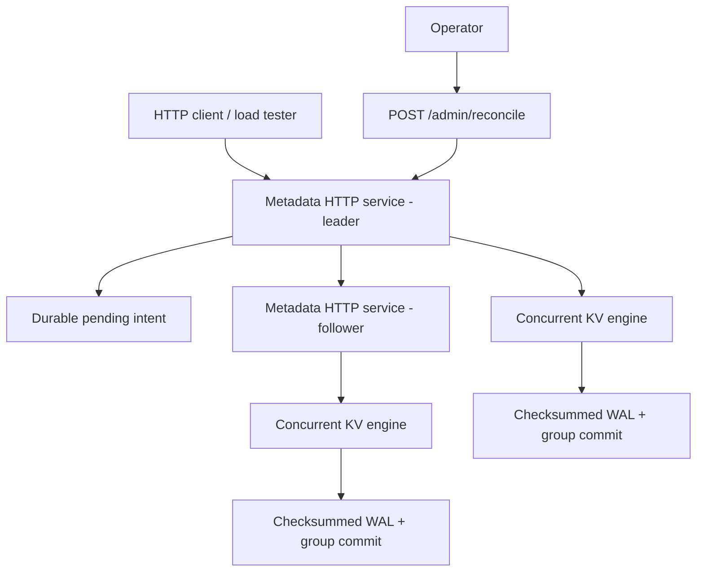

# Architecture and design trade-offs

> Educational Java 21 storage prototype, **not** a production-ready distributed database or Amazon S3 implementation.

## Components

## Write protocol (V5)

1. The leader records one durable pending write intent.
2. It sends a numbered, idempotent PUT or DELETE to the configured follower.
3. The follower applies its durable WAL-backed mutation and acknowledges.
4. The leader applies its local mutation and acknowledges the client.
5. If the follower fails or the outcome is ambiguous, the leader returns HTTP 503 and fences subsequent writes; the intent remains persisted through leader restart.
6. After verifying **the same follower** is back, the operator calls `POST /admin/reconcile` to retry that intent.

## Test coverage

- `StoreTest`: key-value operations, persistence and recovery
- `GroupCommitTest`: concurrent writes and group-commit behavior
- `MetadataTest`: HTTP metadata endpoints
- `ReplicationTest`: basic two-node replication and failure behavior
- `ReconciliationTest`: durable pending intent and manual reconciliation

Run all five tests with `bash scripts/test.sh`. GitHub Actions runs the same command on pushes and pull requests.

## Limits and operational warnings

- This is a two-node demonstration, not a consensus-based HA cluster: no elections, quorum, lease fencing, or automatic failover.
- A follower may become visible ahead of the leader after a failed write; **do not claim linearizability**.
- Follower client reads are not authoritative, and pending-intent recovery requires a human operator.
- `/admin/reconcile` and demo shared-secret authentication are not suitable for public networks. Keep services bound to localhost.
- Use fresh, isolated storage directories for V5; do not silently upgrade V4 WAL data.
- Durability depends on local filesystem and hardware semantics. The tests do not simulate real power loss.
- Performance results are workload- and machine-dependent; publish measured methodology, not assumed numbers.

## Suggested next steps

- Repeatable benchmark reports with latency percentiles and WAL force counts
- Prometheus-compatible metrics and dashboards
- Bounded request queue and write backpressure
- Version-aware reconciliation and fault-injection tests
- Multi-replica protocol design with explicit safety guarantees before implementing automatic failover

See [README-V5.md](README-V5.md) for hands-on Windows replication and reconciliation instructions.
