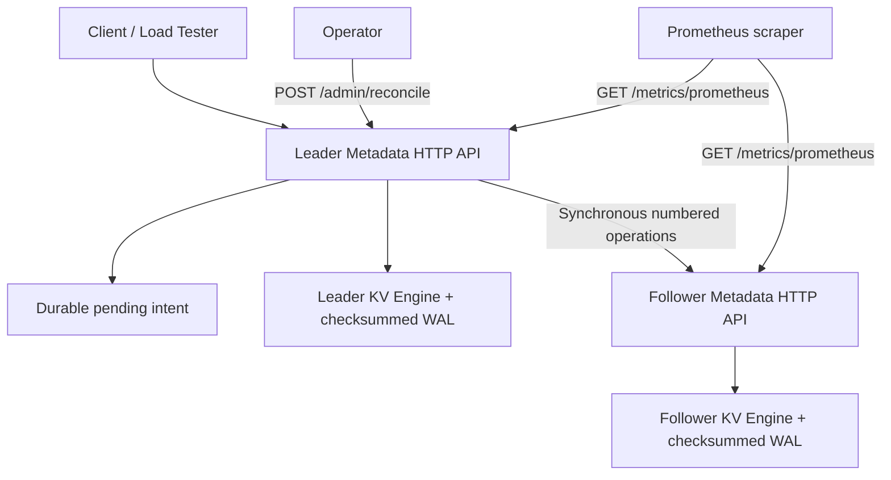

# Distributed Storage Systems in Java

[](https://github.com/MSrikar7/distributed-storage-systems-java/actions/workflows/java-ci.yml)


A hands-on **Java 21 distributed-storage learning project** demonstrating durable write-ahead logging, concurrent batch commits, a two-node leader/follower metadata protocol, manual recovery of uncertain writes, and Prometheus-compatible observability.

**Scope:** A localhost-only engineering prototype, not Amazon S3 or a production-ready highly available storage system. There is no consensus, automatic failover, or linearizability guarantee.

## System overview



The leader records a durable intent, forwards an idempotent operation to the follower, then applies it locally after follower acknowledgment. On an ambiguous replication outcome it fences subsequent writes and requires **operator-triggered reconciliation with the same follower**. This is not a general distributed transaction protocol.

## What is implemented

| Component | Features |
| --- | --- |
| `kv-engine` | Concurrent key-value operations, checksummed WAL, batched `FileChannel.force(true)`, restart recovery and truncated-tail handling |
| `metadata-service` | Java HTTP API, standalone or two-node leader/follower mode, numbered idempotent replica mutations, persistent pending intent and explicit reconciliation |
| `storage-load-tester` | Configurable concurrent read/write/mixed workloads, request throughput, p50/p95/p99 latency and errors |
| V6 observability | `GET /metrics` JSON, `GET /metrics/prometheus` text metrics, WAL timing/batches, reads/writes, key count and local replication fence state |
| GitHub Actions | Java 21 compilation and automated Java test classes on pushes and pull requests |

## Run locally

Requires **JDK 21** and **Bash** (Git Bash or WSL on Windows). No external Java libraries, Maven, Docker, or cloud account needed.

```bash
bash scripts/test.sh
bash scripts/build.sh
java -cp build/kv:build/metadata com.s3index.metadata.MetadataServer ./runtime-v6 8080
```

In another terminal:

```bash
curl -X PUT --data-binary 'hello' http://127.0.0.1:8080/metadata/example
curl http://127.0.0.1:8080/metadata/example
curl http://127.0.0.1:8080/metrics
curl http://127.0.0.1:8080/metrics/prometheus
java -cp build/load com.s3index.load.LoadTester http://127.0.0.1:8080 8 500 mixed
```

On Windows PowerShell, compile with `./scripts/build-windows.ps1` and use classpath separator `;` rather than `:`. See [V5 instructions](README-V5.md) for running and safely reconciling two nodes on Windows.

## Tests and CI

```bash
bash scripts/test.sh
```

The suite covers `StoreTest`, `GroupCommitTest`, `MetadataTest`, `ReplicationTest`, `ReconciliationTest`, and `PrometheusMetricsTest`. The [GitHub Actions workflow](.github/workflows/java-ci.yml) runs the same script with JDK 21.

## Documentation

- [V6 monitoring and Prometheus scraping](README-V6.md)
- [V5 leader/follower replication and operator recovery](README-V5.md)
- [Architecture, safety properties and limitations](ARCHITECTURE.md)

## Important engineering limitations

- **Not production HA:** no leader election, quorum, lease fencing, multi-node consensus, or automatic failover.
- **Not linearizable replicated storage:** the follower can become visible ahead of the leader on ambiguous failure; follower reads are not authoritative.
- **Local demo only:** the replication shared secret and `/admin/reconcile` endpoint are not suitable for untrusted networks; service binds to loopback.
- **Durability depends on storage hardware and filesystem behavior.** Tests do not simulate actual sudden power loss.
- **Metrics are process-lifetime counters**, not end-to-end percentile measurements; benchmark outcomes must be measured, not assumed.

## Next engineering milestones

Fault injection, bounded write queues/backpressure, reproducible benchmark reports, Grafana dashboards, and carefully specified multi-replica consistency behavior.

---

*Built to explore storage engine internals and distributed-system failure modes, with limitations documented explicitly.*
